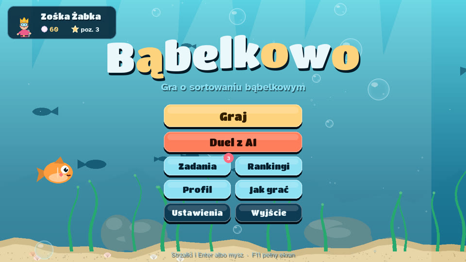
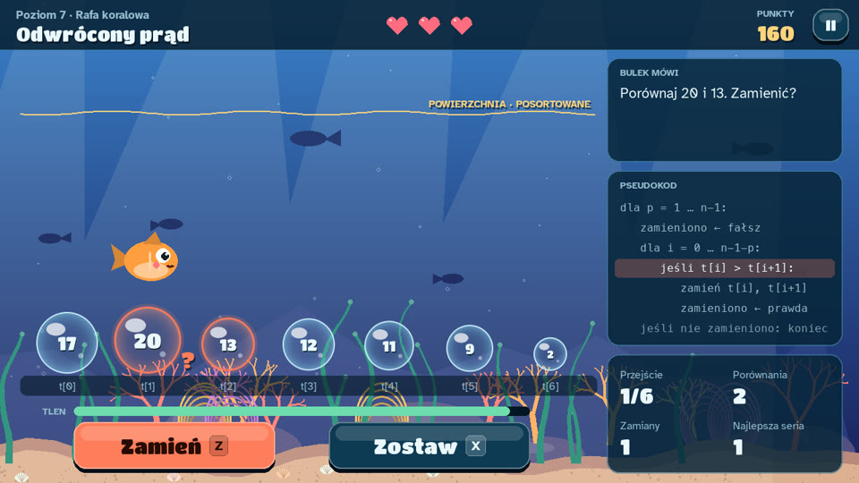
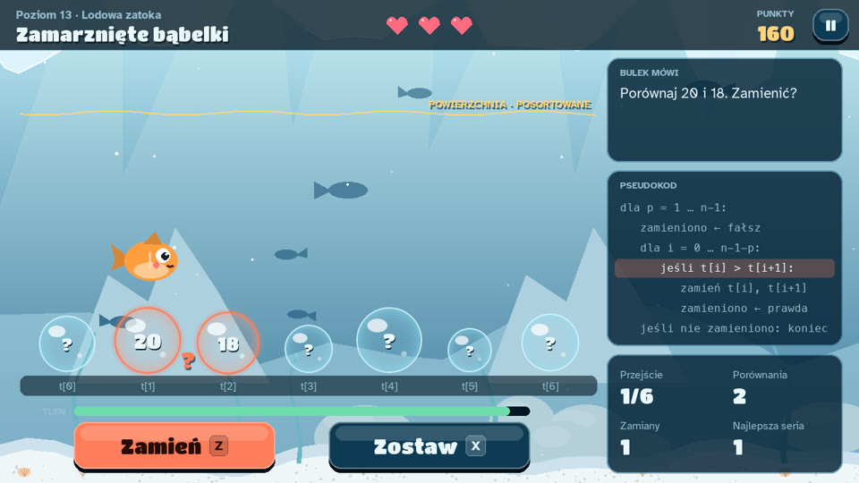
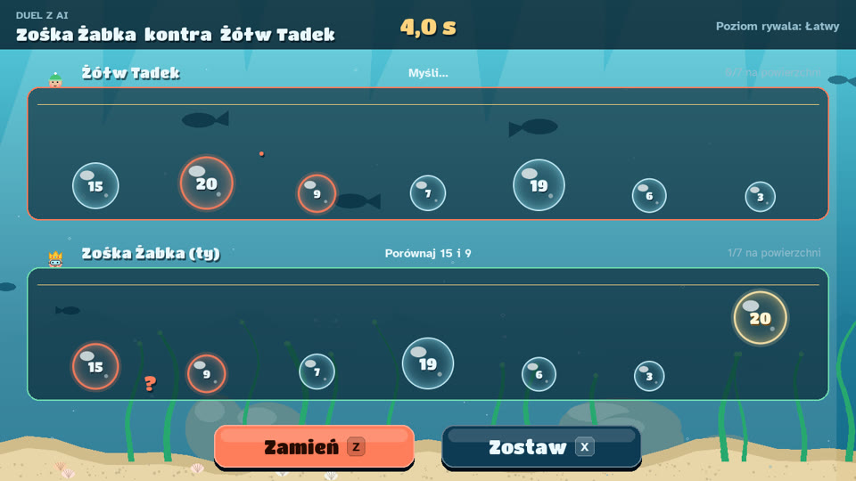
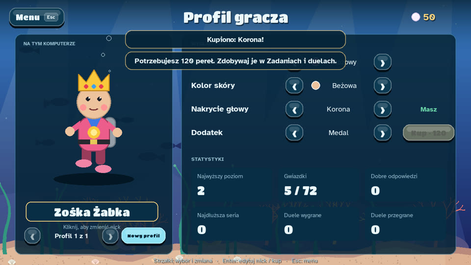
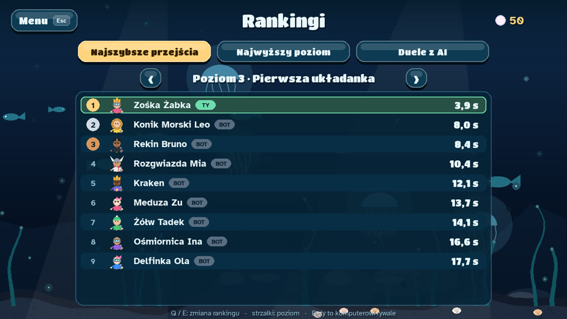
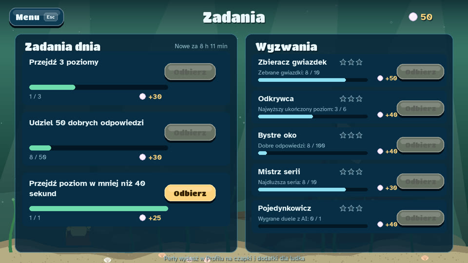
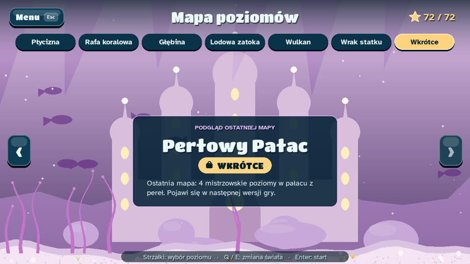

# Bąbelkowo

Gra komputerowa o sortowaniu bąbelkowym.
Napisana w Pythonie z biblioteką pygame-ce. Cała grafika, tła i dźwięki są generowane w kodzie.



| | |
|---|---|
|  |  |
|  |  |
|  |  |
|  | |

## Uruchomienie

**macOS:** pobierz `Babelkowo-macOS.zip` z zakładki
[Releases](../../releases/latest), rozpakuj i otwórz `Babelkowo.app`.
Aplikacja nie jest podpisana, więc przy pierwszym uruchomieniu kliknij ją prawym przyciskiem
i wybierz „Otwórz”.

**Z kodu źródłowego (macOS, Windows, Linux):**

```
pip install -r requirements.txt
python main.py
```

**Własny plik .exe na Windows** (trzeba go zbudować na komputerze z Windows):

```
pip install pygame-ce pyinstaller
pyinstaller --windowed --name Babelkowo --add-data "assets;assets" main.py
```

Gotowa gra pojawi się w folderze `dist\Babelkowo`.

## Co jest w grze

- Menu główne, samouczek (5 stron), ustawienia (muzyka, efekty, pełny ekran, zerowanie postępu)
- Mapa poziomów z sześcioma światami: Płycizna, Rafa koralowa, Głębina, Lodowa zatoka, Wulkan i Wrak statku,
  każdy z własnym animowanym tłem, oraz zakładka „Wkrótce” z podglądem ostatniej mapy (Perłowy Pałac)
- 24 poziomy, gwiazdki (od 1 do 3), punkty, serie, rekordy i zapis postępu
- Maskotka Bulek, pauza, ekran wygranej i przegranej, zakończenie po ostatnim poziomie
- **Profil gracza:** nick, własny ludek-nurek (kolor stroju, skóra, nakrycie głowy, dodatek),
  kilka profili na jednym komputerze, statystyki
- **Perły i sklep:** perły za zadania i duele, wydawane na czapki i dodatki dla ludka
- **Zadania:** 3 zadania dnia (codziennie nowe) i 5 wyzwań z trzema poziomami
- **Rankingi:** najszybsze przejścia każdego poziomu, najwyższy poziom, wygrane duele
  (profile z tego komputera i komputerowi rywale oznaczeni jako BOT)
- **Duel z AI:** wyścig na tej samej tablicy z jednym z 4 botów (od Łatwego do Mistrza), błąd = 1,5 s kary

## Tryby rozgrywki

| Tryb | Co robi gracz | Czego uczy |
|---|---|---|
| Decyzje | przy każdym porównaniu wybiera Zamień (Z) albo Zostaw (X) | warunku `t[i] > t[i+1]` |
| Pytanie o koniec | po każdym przejściu wybiera Dalej albo Koniec | flagi „zamieniono” i przypadku O(n) |
| Układanka | sam zamienia sąsiadów przy ograniczonej liczbie ruchów | inwersji: liczba zamian = liczba inwersji |

Od Rafy koralowej na każdą decyzję jest limit czasu (pasek „tlen”). W Lodowej zatoce liczby są zamrożone
(widać tylko porównywaną parę), a we Wraku statku liczby się powtarzają: równych nie zamieniamy, dlatego
sortowanie bąbelkowe jest stabilne.

## Sterowanie

Mysz albo klawiatura: strzałki i Enter w menu, Z i X w trybie Decyzje,
strzałki i spacja w Układance, Esc to pauza, a F11 włącza pełny ekran.

## Pliki

- `main.py`: okno gry, pętla główna, przejścia między scenami
- `core.py`: czcionki, przyciski, zapis postępu, dźwięki generowane w kodzie
- `world.py`: tła światów, bąbelki, maskotka, cząsteczki
- `levels.py`: definicje 24 poziomów i podgląd ostatniej mapy
- `scenes_menu.py`: menu, mapa poziomów, samouczek, ustawienia, zakończenie
- `scene_game.py`: rozgrywka
- `scene_duel.py`: duel z AI (wybór rywala i wyścig)
- `scene_social.py`: profil, zadania, rankingi
- `ludek.py`: ludek-nurek, sklep z dodatkami, boty
- `quests.py`: zadania dnia i wyzwania

Postęp zapisuje się w pliku `~/.babelkowo/zapis.json`.

Czcionki Titan One i Atkinson Hyperlegible są na licencji SIL Open Font License (pliki w `assets/fonts`).
